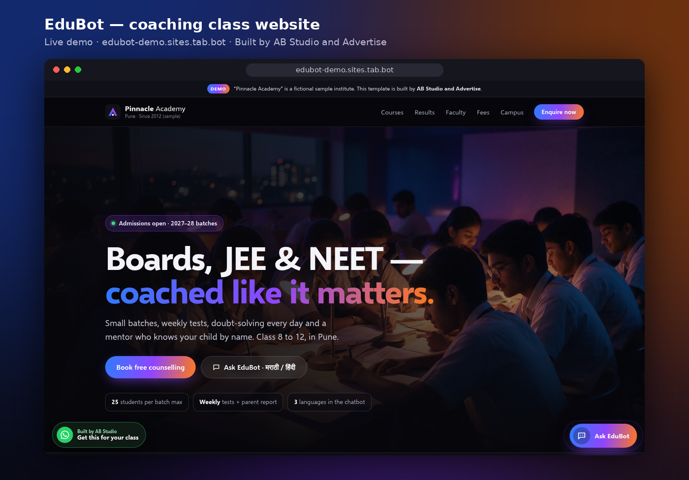
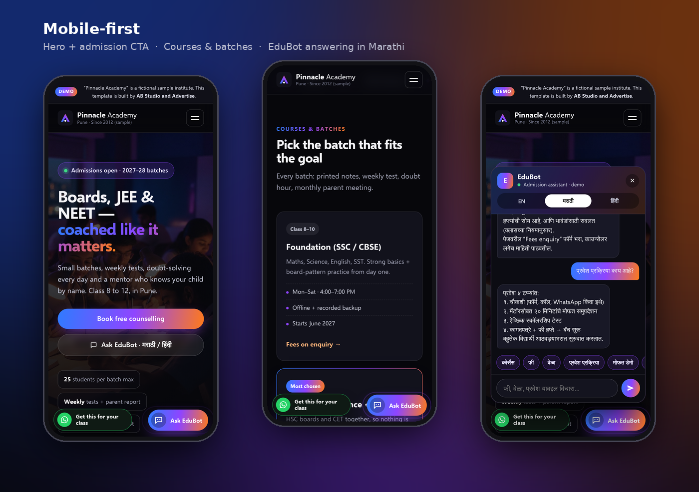
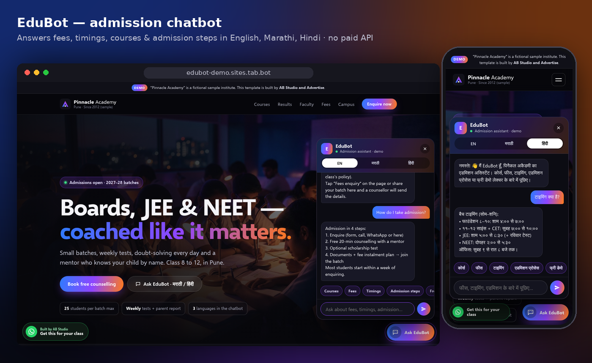

<p align="center">
  
</p>

<h1 align="center">EduBot — admission website + AI chatbot for coaching classes</h1>

<p align="center">
  <b>A premium, mobile-first one-page website template for tuition & coaching classes, with a built-in admission chatbot that answers parents in English, मराठी and हिंदी.</b><br>
  Built by <b>AB Studio and Advertise</b> · Akola · Pune
</p>

<p align="center">
  <a href="https://edubot-demo.sites.tab.bot/"><b>▶ Live demo</b></a> ·
  <a href="https://wa.me/919307643461?text=Hi%20AB%20Studio%2C%20I%20saw%20EduBot%20on%20GitHub%20and%20want%20it%20for%20my%20class.">Get this for your class (WhatsApp)</a>
</p>

> **Demo notice:** “Pinnacle Academy, Pune” is a **fictional sample institute**. Results, faculty, testimonials and counters on the demo are clearly marked placeholders/samples — each class replaces them with its own real content.

---

## Why this exists

Most coaching classes in Maharashtra get their admissions from WhatsApp and word of mouth, and parents ask the same questions again and again — *fees kiti? batch timing kay? admission kasa ghyaycha?* — often late at night. EduBot puts a fast, good-looking website in front of those parents and answers the common questions instantly, in the language the parent is comfortable with, without any paid API.

## Features

- **Premium dark design** — black base with the blue → purple → orange brand gradient, glass cards, smooth motion (respects `prefers-reduced-motion`).
- **Mobile-first** — tested at 390 px and 1440 px, no horizontal overflow, sticky nav with a mobile menu.
- **All the sections a class needs** — hero with admission CTA, boards/exams strip, courses & batches with timings, results (topper cards), faculty, 4-step admission process, fees enquiry form, campus gallery, testimonials, agency CTA.
- **EduBot chatbot** (100 % client-side)
  - English / मराठी / हिंदी toggle, remembers the visitor's choice
  - Auto-switches to Marathi or Hindi when the visitor types in Devanagari
  - Answers: courses, fees enquiry, timings, admission steps, documents, free demo lecture, scholarship, batch size, online/offline, study material, faculty, results, batch start dates, contact
  - Quick-reply chips, typing indicator, keyboard + screen-reader friendly (`aria-live`, Esc to close)
  - **No API keys, no server, no tracking** — the knowledge base is a plain JavaScript object you can edit in minutes
- **WhatsApp click-to-chat** button
- **Enquiry form** with validation (the demo sends nothing; in a client build it is wired to the class's WhatsApp / CRM)
- **Zero dependencies** — plain HTML, CSS and JavaScript. Open `index.html` and it works.

## Screenshots

| Mobile | Chatbot |
|---|---|
|  |  |

## Project structure

```
index.html        – the page (semantic landmarks, accessible labels)
styles.css        – design system + responsive layout
script.js         – EduBot knowledge base + matcher, menu, enquiry form
assets/           – images (AI-generated illustrative photos) and icons
og.png            – link-preview image for WhatsApp / LinkedIn
test/             – Node tests (content, assets, chatbot answers in 3 languages)
screenshots/      – images used in this README
```

## Customise it for a class (10 minutes)

1. **Name & content** — edit the text in `index.html` (institute name, courses, timings, faculty, results, testimonials).
2. **Chatbot answers** — in `script.js`, edit the `KB` array. Each intent has keywords (`k`) and an answer per language (`a.en`, `a.mr`, `a.hi`):
   ```js
   { id: "fees", k: ["fee", "fees", "फी", "फीस", "किती"], a: { en: "…", mr: "…", hi: "…" } }
   ```
3. **WhatsApp number** — replace the `wa.me/…` links.
4. **Photos** — drop real classroom / topper photos into `assets/`.

## Run locally & test

```bash
# any static server works, e.g.
npx serve .
# tests (Node 18+)
node --test
```

## Credits

Designed and built by **AB Studio and Advertise** (AB Graphics) — posters, reels, websites and AI chatbots for coaching classes and local brands in Akola & Pune.
📱 WhatsApp: **+91 93076 43461** · 🌐 https://ab-studio.sites.tab.bot/

Illustrative campus photos on the demo are AI-generated; no real students are shown.

## License

[MIT](LICENSE) © 2026 AB Studio and Advertise
